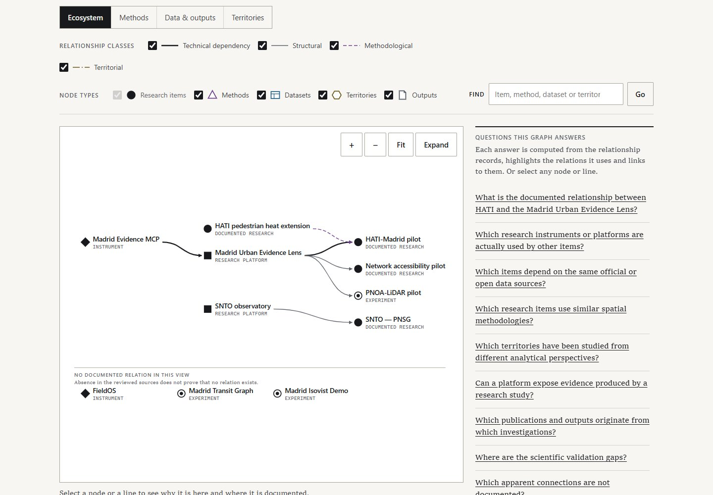
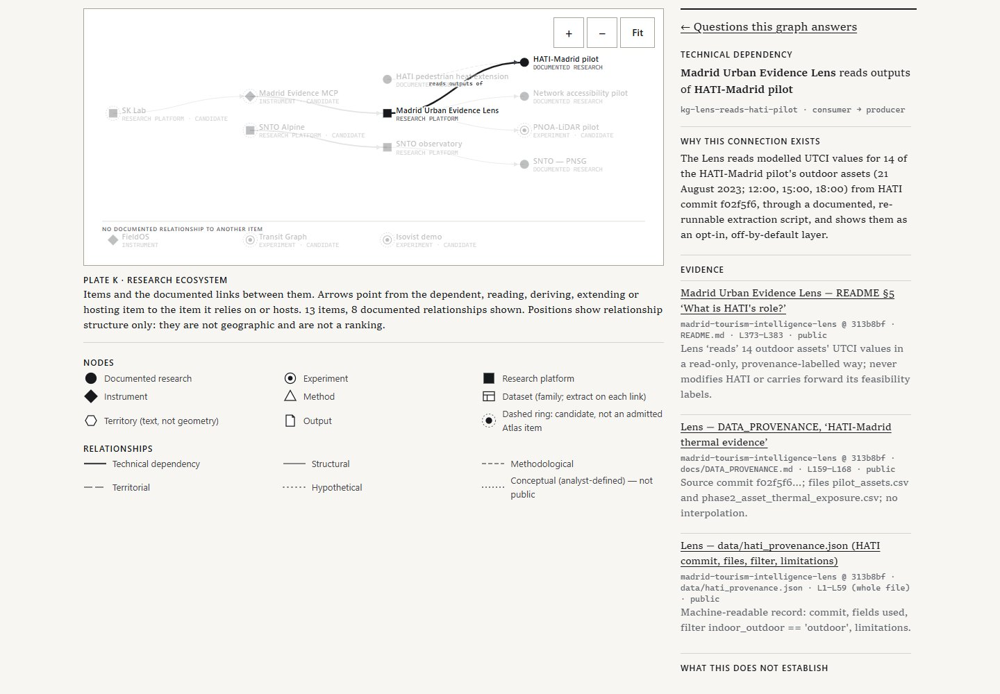
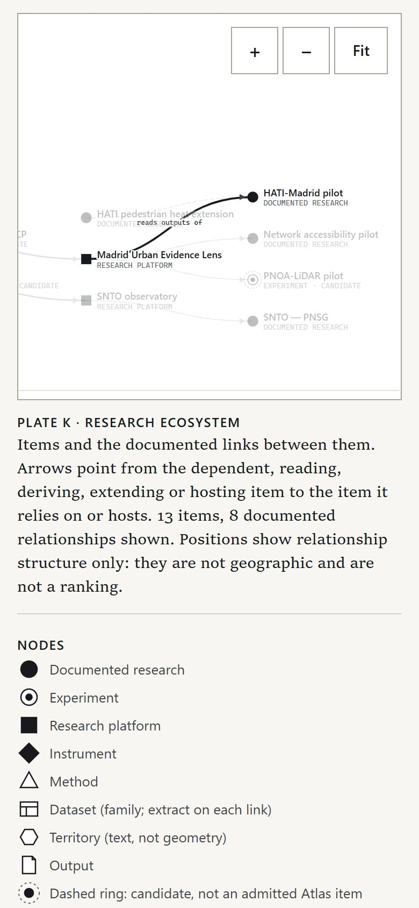
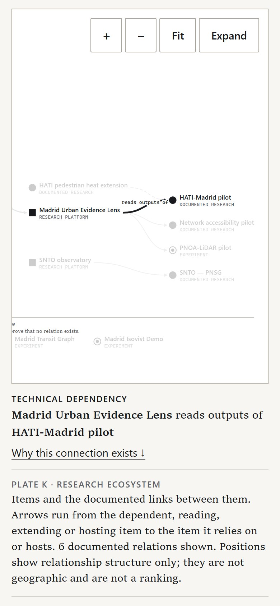

# v0.4 Knowledge Graph — implementation and verification report

**State:** implemented on branch `impl/v0.4-knowledge-graph` from `main`
`5cdf75a`. **Not merged and not released.** It takes effect only when the
maintainer applies `gate-approved`. No tag, release or DOI has been created.

**Evidence base:** PR #22 (audit, ontology, prototype; head `8d69a7d`, kept
unmerged under E4). **Decisions:** E1–E5, approved by the maintainer on
2026-11-26 (`SPEC.md` §13.0).

## 1. Three kinds of checking, kept apart

| Kind | What it establishes | State |
|---|---|---|
| Automated validation | Metadata is well formed and linked: v0.3 invariants (I7 amended), R1–R14, 27 negative tests | **Passes** locally; runs in CI on every pull request |
| AI-assisted source check | Each cited passage was read at its pinned commit by an AI assistant | **Done** for the four items and all 45 relations (PR #22 and this freeze) |
| Human verification | A person confirms that each source supports each claim and relation | **Pending**: `SPEC.md` §13.8 (K2) and v0.3 §12.10 (A2), all rows unchecked |

Nothing in the Atlas presents the second kind as the third.

## 2. What changed

| Area | Change |
|---|---|
| Content (additive) | `data/atlas.json` schema `0.4.0`: four items admitted with full dossiers (Madrid Transit Graph, Madrid Isovist Demo, PNOA-LiDAR pilot, Madrid Evidence MCP), 3 text-only territories, 9 evidence records, 6 findings, 4 outcomes, 1 output and 16 pinned sources. The seven v0.3 records are byte-identical (K1); only `meta` and `schema_version` changed. |
| Relationship dataset | `data/relationships.json`: 45 relations (2 technical, 9 structural, 20 methodological, 14 territorial), 3 documented non-relations, 5 methods, 7 dataset families and 9 relationship-only sources. Relations that mirror v0.3 fields are explicit records, checked both ways against those fields (R8). |
| Runtime | `js/graph.js` (new, `#/graph`); loading in `js/data.js`; routing in `js/main.js`; a “Documented relations” section in every dossier (`js/dossier.js`); counts and About text in `js/views.js`; styles in `styles.css`. Still eight modules, no dependency, no third-party request. |
| Validation | `tools/validate_relationships.py` (R1–R14), run by `tools/validate_atlas.py`; `tests/test_relationships.py` (27 negative tests); CI runs both. |
| Governance | The gate regex now also covers `data/relationships.json`, `tools/`, `tests/` and `.github/workflows/`. |
| Specification | `SPEC.md` §13, with inline markers where v0.3 rules are superseded (§1.2, I7, §5, §6, A1, A8); `DESIGN_CONTRACT.md` §17; `PROJECT_STATUS.md` §6.2; `docs/v0.4/DEVELOPMENT_RECORD.md` (E5). |
| Prototype | Not included (E4). R14 fails the build if a `prototype/` directory ever appears. |

## 3. Acceptance criteria (SPEC §13.9)

| # | Status | Evidence |
|---|---|---|
| K1 | **Pass** | The seven v0.3 records are unchanged (asserted while authoring); every v0.3 invariant passes except I7, which §13.4 amends explicitly. |
| K2 | **Pending** | Human verification of every relation: §13.8, all rows unchecked. |
| K3 | **Pass** (local) | `validate_atlas.py` OK with R1–R14; 27/27 negative tests pass. The CI result is to be read on the pull request. |
| K4 | **Pass** | Only the four production classes exist; R2 and R3 reject hypothetical, conceptual and deferred nodes (tests). |
| K5 | **Pass** | Relation panel: class, direction, explanation, extract, versions, sources with pin and line range, limits and inference rules, verification state; the node panel links to the dossier. |
| K6 | **Pass** | Each view lists unconnected items in a band with the absence statement. |
| K7 | **Pass** | Deterministic layered layout; R11 forbids score-like fields. |
| K8 | **Pass** | Four deep links reloaded to the same view and panel; a text table of the current view. |
| K9 | **Pass** | axe-core: 36 states, 0 violations (graph states and all Atlas routes, desktop, dark, forced colours, 390 px). Keyboard: roving focus, Enter, Escape, table rows. 200 % zoom (720 CSS px): no overflow. Reduced motion: zoom applied without animation. |
| K10 | **Pass** | 0 third-party requests across every run; static files only. |
| K11 | **Pass** | The §13.1–§13.2 content freeze precedes every relation to a new item; its human verification is pending under K2. |
| K12 | **Pass** | A2 is shown as pending in the footer, About, the graph and the status record. |

## 4. Prototype and production, compared

| | Prototype (PR #22) | Production |
|---|---|---|
| Plate | 8/4 split; the ecosystem drawn at about 0.8 scale on a 1440 px screen | full-width plate beside a 360 px rail, 480–820 px high; an expanded view fills the window |
| Layout | layered, fixed column width; links crossed labels | column widths measured from the labels; links leave at the label end and enter at the glyph; virtual waypoints route long links through gaps |
| Labels | 13 px | 14.5 px with a halo; predicate labels for the selection, nudged apart |
| Classes | line pattern only, achromatic | line pattern, weight and restrained colour (tokens in light and dark; CanvasText in forced colours) |
| Hierarchy | dimming | the selection in ink with a ring, neighbours at full strength, the rest at 22 % (nodes) and 10 % (lines) |
| Neighbourhood | radial | incoming relations on the left, outgoing on the right |
| Keyboard | every node a tab stop | one tab stop, spatial arrow-key roving, Enter, `+ - 0 F`, Escape |
| Mobile | readable minimum scale | the same, plus a selection bar linking to the details |
| Versions | in the text | a “Versions (never substituted)” block on technical relations (E3) |
| Scope | candidates and inventory toggles | admitted items only; hypothetical and conceptual readings removed (E5) |

| Prototype | Production |
|---|---|
|  |  |
|  |  |
|  |  |

## 5. Final screenshots (`screenshots/`)

- Desktop, 1440 px:
  - `01` ecosystem
  - `02` HATI ↔ Lens relation
  - `03` MCP → Lens, with both versions
  - `04` methods
  - `05` shared-data question
  - `06` territories
  - `07` neighbourhood of the Lens
  - `08` structural relation (hosting)
  - `09` territorial relation
  - `10` methodological relation (dataset)
  - `11` versions question
  - `12` not-documented question
  - `13` expanded view
  - `14` text alternative
  - `15` relations in the MCP dossier
  - `16` Transit Graph dossier
  - `17` dark theme
  - `18` forced colours
- Mobile, 390 px: `19`–`23`.
- Zoom 200 %: `24`.

## 6. Genuine blockers

1. **Human verification (K2, A2).** Only the maintainer can complete
   `SPEC.md` §13.8 and §12.10. Until then the Atlas says so everywhere.
2. **Gate approval.** The pull request changes governed files and needs the
   maintainer's `gate-approved` label. This report does not apply it.
3. **Release.** No tag, release or DOI is created; that needs separate
   authorisation.
