# v0.4 proposal — Spatial Research Relationship Graph

**State:** proposal for decision. Not approved and not released. Nothing in
this document or in `prototype/v0.4-knowledge-graph/` changes the released
v0.3.0 Atlas, its dataset, its specification or its historical records.

**Prepared:** 2026-11-26, on branch `proposal/v0.4-knowledge-graph` from
`main` at `5cdf75a`.

**Decision requested from the maintainer:** approve, amend or reject the scope
in §2, the ontology in §5, the architecture in §6 and the escalations in §9.
Approval opens a v0.4 specification gate (§11). It does not admit any item or
relationship to the Atlas.

---

## 1. Verified baseline

| Fact | Verified state (2026-11-26) |
|---|---|
| `main` | `5cdf75a` (merge of PR #21, release commit `f550bb8`); PRs #19, #20 and #21 merged |
| Tags | `v0.1.0`, `v0.1.1`, `v0.2.0`, `v0.2.1` only. **No `v0.3.0` tag and no DOI exist.** |
| Dataset | schema `0.3.0`: 7 items, 5 territories, 3 geometries, 15 evidence records, 14 findings, 5 outcomes, 5 outputs, 5 figures, 23 sources, **0 relationships** |
| `tools/validate_atlas.py` | passes I1–I13, I15–I18 on this branch (unchanged) |
| Governance | `SPEC.md` §1.2 and I7: "v0.3.0 contains zero relations between research items"; `#/relations` not rendered (§5). Governed files need `gate-approved` (ruleset `23958517`). |
| A2 (SPEC §12.10) | human verification **pending**; every row unchecked |

v0.4 therefore needs a **new approved specification**. This proposal does not
use the v0.3 relationship vocabulary in the released dataset; it shows what a
v0.4 specification would govern.

## 2. Recommendation

**Build v0.4 as a complementary "Relationships" view over a separate,
validated static file (`data/relationships.json`), rendered as native SVG
with a deterministic layout, and admit only relationships documented by a
pinned public source in the dependent item's own repository.**

Recommended v0.4 scope:

1. **Relationships among the seven existing Atlas items**, plus the dataset,
   method and territory nodes they need. That is 4 documented links among
   Atlas items: the Lens reads HATI pilot outputs; the HATI extension extends
   the pilot; the Lens hosts the network pilot; the SNTO observatory hosts
   SNTO — PNSG. The last two already exist as v0.3 `hosts` fields.
2. **At most four new candidate items**, each through its own content-freeze
   gate before any relationship to it is published: Madrid Evidence MCP,
   PNOA-LiDAR pilot, Madrid Transit Graph and Madrid Isovist Demo. They
   answer the mission's questions about instruments, PNOA work and
   territories studied from several perspectives. SNTO Alpine and SK Lab are
   optional (escalation E2).
3. **Out of v0.4:** conceptual (analyst-defined) relationships in the public
   graph, numerical confidence, evidence and findings as graph nodes,
   Tourism Intelligence Desk, Spatial Investigation Studio, and every private
   repository.

The dossiers stay the academic reading environment. The graph is the
exploration environment: every node links to its dossier, and every line
links to the exact lines of the pinned source that justify it.

## 3. Discovery results (Phase A)

All public repositories of the owner were listed (`gh repo list`), and the
candidates were shallow-cloned read-only and searched for cross-references.
Every relationship below was read at the pinned commit.

| Candidate | Repository (pin) | Visibility · code licence | Documented state (verbatim where quoted) | Eligibility |
|---|---|---|---|---|
| HATI-Madrid pilot | heat-adaptive-tourism-madrid `97b0e40` | public · MIT (src/tests/app) | v0.3 item `r-hati-pilot` | In Atlas |
| HATI pedestrian heat extension | same repository | public | `ABSTAIN / NO ROBUST DIFFERENCE` | In Atlas |
| SNTO observatory · SNTO — PNSG | snto-smart-tourism-observatory `069df54` | public · custom academic | `INSUFFICIENT EVIDENCE TO PRIORITISE` | In Atlas |
| Madrid Urban Evidence Lens · Network Accessibility Pilot | madrid-tourism-intelligence-lens `313b8bf` | public · MIT | `MODIFY` (pilot) | In Atlas |
| FieldOS | fieldos `b3fdad3` | public · Apache-2.0 | `FIRST FIELD RUN: PASS — owner-attested` | In Atlas |
| **PNOA-LiDAR Madrid pilot** | hosted in the Lens repository | public · MIT (host) | "NO-GO for the production viewer; research line kept (MODIFY)" | Candidate |
| **Madrid Evidence MCP** | sk-spatial-intelligence-lab `3e4959b` | public · **no licence file** | "Engineering prototype, not independently validated, not hosted"; evaluations MODIFY (provisional) | Candidate, pending E1 |
| **SK Spatial Intelligence Lab** | same | public · **no licence file** | per-component status table | Candidate, pending E1 |
| **Madrid Transit Graph** | madrid-transit-graph `a9ff926` | public · MIT, ODbL data | "CONGELADO (FREEZE) desde 2026-11-21"; studies NEEDS_VALIDATION | Candidate |
| **Madrid Isovist Demo** | madrid-isovist-demo `932cd61` | public · MIT | Step 0 verdict "MIXTO" | Candidate |
| **SNTO Alpine Edition** (discovered) | snto-alpine `777e214` | public · custom academic | "prototipo reproducible sin validación de campo" | Candidate, optional |
| Tourism Intelligence Desk (discovered) | tourism-intelligence-desk `e6b75fb` | public · no licence | prototype v0.7 | Deferred (development inventory) |
| Spatial Investigation Studio | in SK Lab | public | "Not validated" | Deferred |
| PNOA temporal analysis (rooftop PV observatory) | madrid-rooftop-pv-observatory | **private** | — | Excluded |
| Shade Gate Madrid · MVA isovist research · CHALUS | — | **private** | — | Excluded |

What the sources show, in one sentence each:

- **HATI ↔ Lens** is a real, bounded technical dependency: the Lens reads
  modelled UTCI for 14 outdoor pilot assets on one day from HATI commit
  `f02f5f6` (verified to exist), and never carries HATI's verdicts.
- **MCP → Lens** is a pinned dependency on Lens commit `f67cd47`, not on the
  Lens version the Atlas dossier describes.
- **Hosting is not integration**: the Lens hosts the network pilot and the
  PNOA-LiDAR pilot, and both READMEs state, with a test, that the Lens
  application does not reference them.
- **FieldOS is explicitly not integrated** with SNTO or HATI (its product
  contract lists it as a non-goal). This is recorded as a documented
  non-relationship so that topical proximity is not read as a link.
- **PNOA is not one dataset**: HATI uses LiDAR 1st coverage (WCS, 2008–2015),
  the PNOA-LiDAR pilot uses LiDAR 3rd coverage (MDS/MDT 50 cm), and the Lens
  uses historical orthophotos "as a visual aid, not evidence". They stay
  three separate nodes.
- **Transit Graph and Isovist Demo** have no documented relationship to any
  other item. The graph shows that absence explicitly.

## 4. Relationship inventory

Full records, with explanation, quoted summary, limits and source URLs, are
in [`prototype/v0.4-knowledge-graph/graph.json`](../../prototype/v0.4-knowledge-graph/graph.json).
The prototype also derives 13 links unchanged from existing v0.3 fields
(`hosts` ×2, `territory_ids` ×6, `output.research_id` ×5).

### 4.1 Links between items (the core of the proposal)

| # | From | Relationship | To | Class | Pinned evidence |
|---|---|---|---|---|---|
| 1 | Madrid Urban Evidence Lens | reads outputs of | HATI-Madrid pilot | technical | Lens@`313b8bf` [`README.md` L373–383](https://github.com/soroushkarahrodi79-oss/madrid-tourism-intelligence-lens/blob/313b8bf0ca3d3cd8d559c0eb18752970205d9a7c/README.md#L373-L383); [`docs/DATA_PROVENANCE.md` L159–168](https://github.com/soroushkarahrodi79-oss/madrid-tourism-intelligence-lens/blob/313b8bf0ca3d3cd8d559c0eb18752970205d9a7c/docs/DATA_PROVENANCE.md#L159-L168); [`data/hati_provenance.json`](https://github.com/soroushkarahrodi79-oss/madrid-tourism-intelligence-lens/blob/313b8bf0ca3d3cd8d559c0eb18752970205d9a7c/data/hati_provenance.json#L1-L59) |
| 2 | Madrid Evidence MCP | depends on | Madrid Urban Evidence Lens | technical | SK Lab@`3e4959b` [`mcp/madrid-evidence/README.md` L32–44](https://github.com/soroushkarahrodi79-oss/sk-spatial-intelligence-lab/blob/3e4959bed16a9e960803bc803877115c0784568a/mcp/madrid-evidence/README.md#L32-L44); [`lens-pin.json` L1–6](https://github.com/soroushkarahrodi79-oss/sk-spatial-intelligence-lab/blob/3e4959bed16a9e960803bc803877115c0784568a/mcp/madrid-evidence/lens-pin.json#L1-L6) |
| 3 | SNTO Alpine | derived from | SNTO observatory | technical | snto-alpine@`777e214` [`README.md` L16–18](https://github.com/soroushkarahrodi79-oss/snto-alpine/blob/777e2140664d6dc68f9be0b46c536bf91056aff0/README.md#L16-L18); [`.zenodo.json` L25–31](https://github.com/soroushkarahrodi79-oss/snto-alpine/blob/777e2140664d6dc68f9be0b46c536bf91056aff0/.zenodo.json#L25-L31) (`isDerivedFrom`) |
| 4 | HATI pedestrian heat extension | extends | HATI-Madrid pilot | methodological | HATI@`97b0e40` [`README.md` L22–31](https://github.com/soroushkarahrodi79-oss/heat-adaptive-tourism-madrid/blob/97b0e40669386c29dafa8c2f5b5031f14ff71771/README.md#L22-L31); [`PROJECT_STATUS.md` §B.4](https://github.com/soroushkarahrodi79-oss/heat-adaptive-tourism-madrid/blob/97b0e40669386c29dafa8c2f5b5031f14ff71771/PROJECT_STATUS.md#L254-L261); [`RESEARCH_PROTOCOL_V0.1.md` L24–30](https://github.com/soroushkarahrodi79-oss/heat-adaptive-tourism-madrid/blob/97b0e40669386c29dafa8c2f5b5031f14ff71771/docs/research/pedestrian-heat/RESEARCH_PROTOCOL_V0.1.md#L24-L30); [`GATE1_FEASIBILITY_DOSSIER.md` L99, L140](https://github.com/soroushkarahrodi79-oss/heat-adaptive-tourism-madrid/blob/97b0e40669386c29dafa8c2f5b5031f14ff71771/docs/research/pedestrian-heat/GATE1_FEASIBILITY_DOSSIER.md#L99-L140) |
| 5 | SK Lab | hosts | Madrid Evidence MCP | structural | SK Lab@`3e4959b` [`README.md` L22–36](https://github.com/soroushkarahrodi79-oss/sk-spatial-intelligence-lab/blob/3e4959bed16a9e960803bc803877115c0784568a/README.md#L22-L36) |
| 6 | Madrid Urban Evidence Lens | hosts | PNOA-LiDAR pilot | structural | Lens@`313b8bf` [`research/pnoa_lidar_madrid_pilot/README.md` L1–22, L103–106](https://github.com/soroushkarahrodi79-oss/madrid-tourism-intelligence-lens/blob/313b8bf0ca3d3cd8d559c0eb18752970205d9a7c/research/pnoa_lidar_madrid_pilot/README.md#L1-L22) |
| 7 | SNTO observatory | possible future application to | FieldOS | **hypothetical** (off by default) | SNTO@`069df54` [`experiments/vis001_madrid_counting/README.md` L262–274](https://github.com/soroushkarahrodi79-oss/snto-smart-tourism-observatory/blob/069df54634d71e1c42f5c37aaf61b40b895464a0/experiments/vis001_madrid_counting/README.md#L262-L274) |
| — | Lens → network pilot; SNTO observatory → SNTO — PNSG | hosts | — | structural | existing v0.3 `hosts` fields |

### 4.2 Method, dataset and territory links

| Predicate | Links | Sources |
|---|---|---|
| applies method (6) | HATI pilot and HATI extension → SOLWEIG/UTCI; network pilot → network vs straight-line distance; SNTO — PNSG → Mann-Kendall/Sen; Isovist → 2D isovist; Transit Graph → topological graph perturbation | v0.3 methodology sources (`s-hati-preprint`, `s-hati-gate3b`, `s-net-readme`, `s-snto-brief`); `ks-isovist-readme`, `ks-transit-readme` |
| uses dataset (14), each with its extract | OpenStreetMap ×5 (HATI pilot, HATI extension, network pilot, Transit Graph, Isovist); Sentinel-2 ×3 (SNTO — PNSG, SNTO observatory, SNTO Alpine); Madrid administrative geography ×2 (Lens, PNOA-LiDAR pilot); PNOA-LiDAR 1st coverage (HATI pilot); PNOA-LiDAR 3rd coverage (PNOA-LiDAR pilot); PNOA historical orthophotos (Lens); OAPN cartography (SNTO — PNSG) | as listed per record in `graph.json` |
| situated in (4 new) | PNOA-LiDAR pilot → Embajadores (012); Isovist → Lavapiés (isovist area); Transit Graph → Metro de Madrid network; SNTO Alpine → Sierra Nevada NP | `ks-lens-pnoa-pilot`, `ks-isovist-readme`, `ks-transit-readme`, `ks-alpine-readme` |
| lies within (5) | Prado–Retiro–Atocha box, Atocha → Puerta de Alcalá, San Isidro (113), Embajadores (012), Lavapiés (isovist area) → Madrid (municipality) | v0.3 territory sources; `ks-lens-pnoa-pilot`; `ks-isovist-readme` |

### 4.3 Documented non-relationships

| Subject | Not related to | Source |
|---|---|---|
| FieldOS | SNTO, SNTO — PNSG, HATI pilot, HATI extension | FieldOS `PRODUCT_CONTRACT.md` §6 L100–104 ("SNTO / HATI integration" is a non-goal) |
| Lens application | Network Accessibility Pilot | pilot README L18–22 (isolation asserted by a test) |
| Lens application | PNOA-LiDAR pilot | pilot README L103–106 (isolation asserted by a test) |
| SNTO application | VIS-001 / FieldOS | VIS-001 README L1–7 ("not an SNTO feature") |

### 4.4 Development candidate inventory (never public)

| Id | Status | Reading | Decision |
|---|---|---|---|
| `cand-conc-network-transit` | candidate | network pilot ~ Transit Graph (analyst) | Kept out: the method nodes already show they apply different methods |
| `cand-conc-isovist-pnoa` | candidate | Isovist ~ PNOA-LiDAR pilot (analyst) | Kept out: extents not compared; the territory view shows two separate areas |
| `cand-desk-hati`, `cand-desk-snto` | deferred | Desk reads outputs of HATI pilot / SNTO — PNSG | Deferred: node outside v0.4, no licence; "independently re-executed" is an owner reproduction |
| `cand-studio-mcp` | deferred | Studio depends on MCP | Deferred: local, unhosted, unvalidated |
| `rej-share-hati-territory` | rejected | "HATI extension studied the pilot's area" | Rejected: "same corridor" is not the same study area |

**Recommendation on the inventory question:** unresolved, analyst-defined
and deferred readings stay out of the public graph, in a development
inventory that reviewers can switch on. The prototype shows both states so
that the difference can be judged.

## 5. Ontology

Five node kinds, twelve predicates and six classes. Each predicate has a
definition, domain and range, direction, required evidence, interpretation
limit and inference rules (`graph.json` → `predicates`).

| Node kind | Justification | Rejected alternatives |
|---|---|---|
| Research item (v0.3 classes unchanged) | The unit of the Atlas | Separate "software component", "platform" and "instrument" types: the v0.3 `class` already separates them |
| Method | Answers "which items use similar methods" without asserting equivalence | Hypothesis, research question (a field of the item, not a node) |
| Dataset (family) | Answers "same data sources"; the extract lives on the link | One node per extract (would hide the shared provenance question) |
| Territory | v0.3 records plus candidate territories; text, not geometry | Spatial unit as a separate kind (adds nothing without geometry) |
| Output | v0.3 outputs; answers lineage questions | Publication as a separate kind (v0.3 `publication_type` covers it) |

Evidence, findings and limitations stay **inside the dossier**: they already
have one parent each (v0.3 I8), and turning 29 records into nodes adds clutter,
not meaning. The node panel lists an item's findings and links to its dossier.

| Class | Predicates | Public | Line |
|---|---|---|---|
| technical | depends on · reads outputs of · derived from | yes | heavy solid |
| structural | hosts · has output | yes | solid |
| methodological | extends · applies method · uses dataset | yes | dash |
| territorial | situated in · lies within | yes | long dash |
| hypothetical | possible future application to | yes, **off by default** | sparse dots, open arrow |
| conceptual | conceptually related (analyst) | **no**, inventory only | dots, no arrow |

**Rejected predicates:** `SHARES_*` (stored equivalence; read instead from two
independent links), `ADDRESSES_RELATED_QUESTION` (no source-based test),
`CONTRASTS_WITH` (would be an Atlas comparison, v0.3 non-goal 7),
`PRODUCES_EVIDENCE`/`SUPPORTS_FINDING`/`DOCUMENTS` (already v0.3 one-parent
fields), `IMPLEMENTS` (no case), and numerical confidence (no defensible method).

**Rules that prevent misleading inference** (enforced by the validator where
mechanical):

- a technical link must be documented in the **dependent** item's own
  repository (G5);
- every dataset link records its extract, product or vintage (G5);
- conceptual links cannot be public (G6); hypothetical links are off by
  default and never counted as use (G6, UI);
- no public link may touch a deferred node (G6);
- no score, weight, rank or confidence field may exist (G8, carrying v0.3 I10
  forward);
- verification is recorded as an AI-assisted source check with human
  verification pending, never as human verification (G9).

## 6. Architecture decision

Measured size: 41 nodes and 49 public links (36 proposed + 13 derived from
v0.3). At most 20 nodes are drawn in any one view.

| Option | Fit | Decision |
|---|---|---|
| **Native SVG, deterministic layered layout** | Every node is a focusable DOM element; prints; inherits the Atlas tokens and dark mode; no dependency; same picture on every load | **Chosen** |
| Canvas | Needed only for thousands of nodes; loses DOM accessibility and print | Rejected |
| Library (Cytoscape.js, Sigma, D3-force) | Adds a dependency and a licence review; force layouts move between loads, against the determinism of v0.3 I9 | Rejected |
| Precomputed coordinates | Equivalent output; a build step that v0.3 non-goal 12 forbids | Not needed at this size. The layout function is deterministic, so coordinates can be baked later without changing the picture. |
| Graph database, server, API, embeddings, LLM | Nothing in the questions needs them; v0.3 non-goal 10 forbids them | Rejected |

Integration with the existing runtime (implementation gate): one new route
`#/relations` (reserved in SPEC §5 as deferred), one new module
`js/relations.js` (about 900 lines, from the prototype), a new data file
`data/relationships.json` (the prototype's `graph.json` minus inventory
entries), dossier links "Relationships of this item", and the validator
merged into `tools/validate_atlas.py` as invariants I19–I27. Static GitHub
Pages deployment is unchanged.

## 7. Prototype (Phase C)

`prototype/v0.4-knowledge-graph/` is isolated: it reads `data/atlas.json`
read-only, touches no governed file, carries a "Prototype · not part of the
released Atlas" banner and `noindex`, and loads nothing from third parties.

Run it from the repository root:

```
python -m http.server 8000
# open http://localhost:8000/prototype/v0.4-knowledge-graph/
python prototype/v0.4-knowledge-graph/validate_graph.py
```

Interactions:

- four views (Ecosystem, Methods, Data & outputs, Territories) and a
  neighbourhood view for any node;
- pan, wheel and pinch zoom, Fit; search; class filters; hypothetical and
  development-inventory toggles;
- node and link selection with a full provenance panel;
- ten preset research questions, whose answers are computed from the
  records and highlight the links they use;
- a deep link for every state (`#view=…&edge=…`);
- a text table of the current view, the documented non-relationships and the
  vocabulary.

Each view sends unconnected items to a labelled band ("No documented
relationship…"), so absence is shown, not hidden.

### Verification performed (headless Edge, 2026-11-26)

| Check | Result |
|---|---|
| `validate_graph.py` (G0–G9) | PASS. Negative test: 4 injected faults (wrong-repository technical link, missing extract, public conceptual link, score field), all 4 caught |
| `tools/validate_atlas.py` | PASS, unchanged |
| axe-core (WCAG 2.0–2.2 A/AA), 12 states, desktop, dark and 390 px | 0 violations (after fixing two target-size findings) |
| Horizontal overflow, 360/390/768/1024/1440 px × 5 states | none (after fixing tab wrapping) |
| Third-party requests · console errors | none · none |

The in-app browser review also found and fixed two problems: a whole-graph
fit that was unreadable on phones (now a legible minimum scale, centred on
the selection, with Fit showing everything), and zoom controls covering
labels.

Not yet checked: forced-colours mode, 200 % zoom and full keyboard-only
traversal. They are part of K9.

### Screenshots

| | |
|---|---|
| 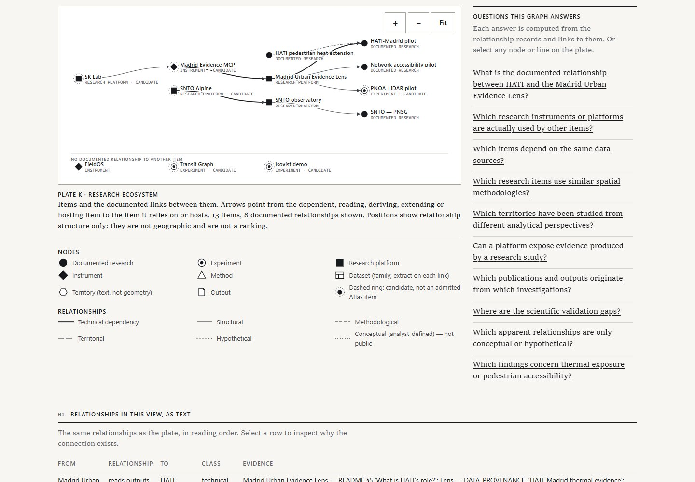 Ecosystem view, three items with no documented relationship in their own band | 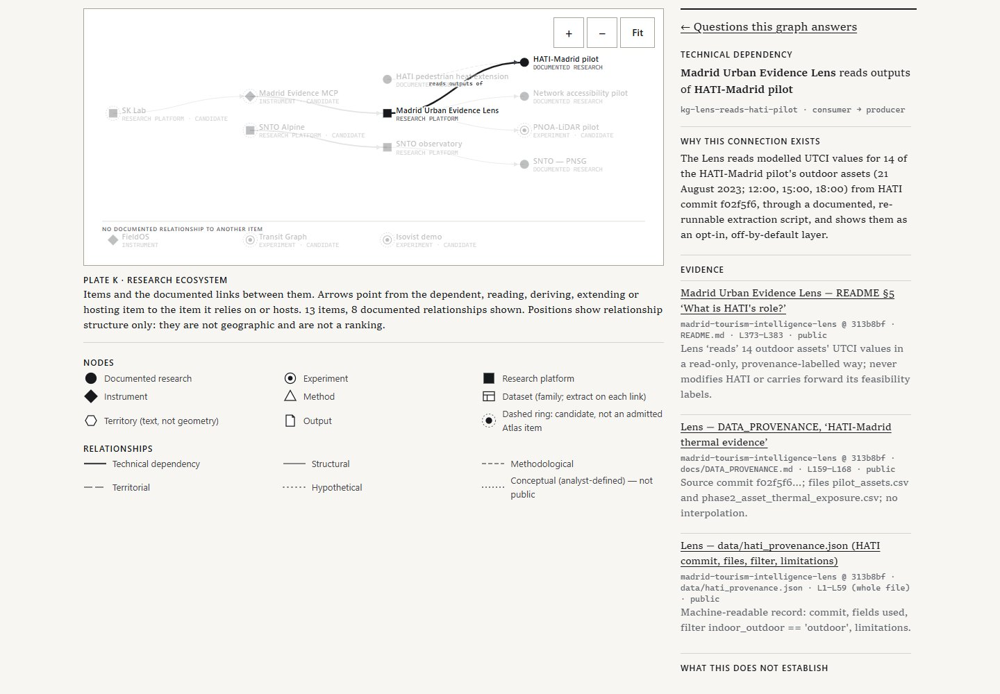 Selecting a link: why it exists, pinned lines, what it does not establish |
| 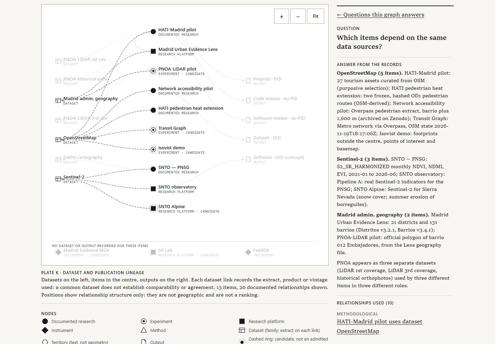 "Which items depend on the same data sources?" with extracts per item | 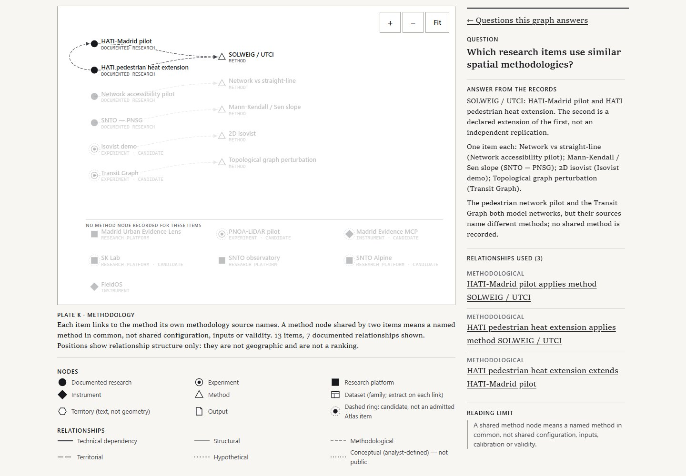 Methods: only SOLWEIG/UTCI is shared, by a declared extension |
| 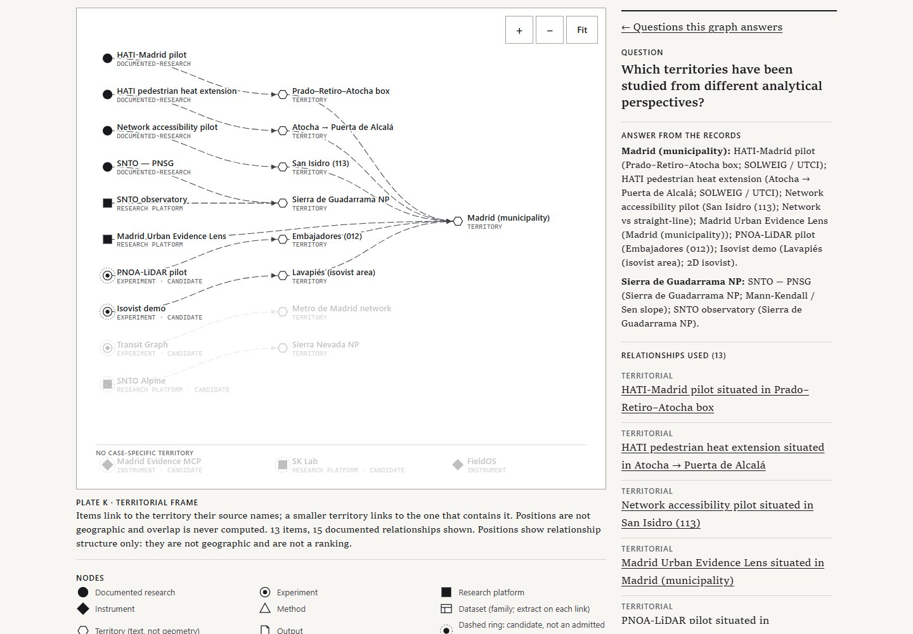 Territories studied from several perspectives; siblings not compared | 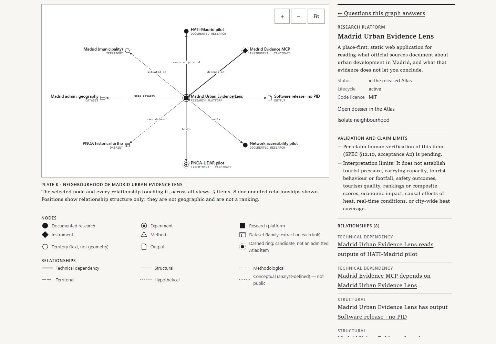 Neighbourhood of the Lens across all views |
| 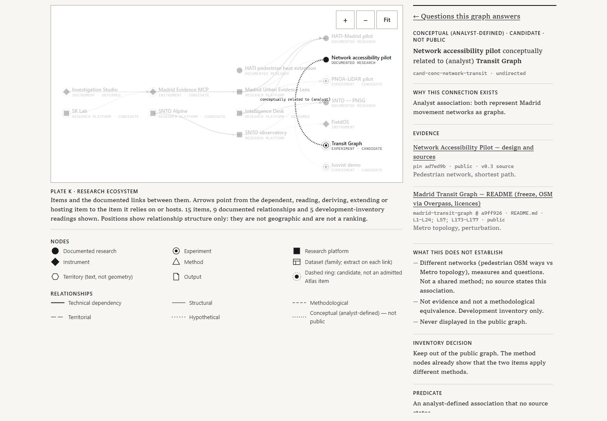 Development inventory switched on: an analyst-defined link, marked not public | 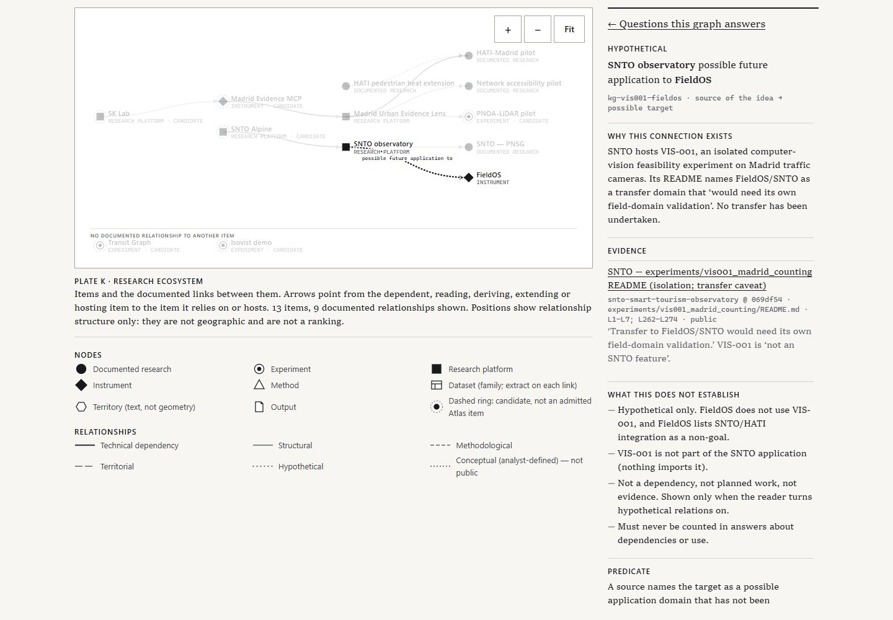 The only hypothetical link, off by default |
| 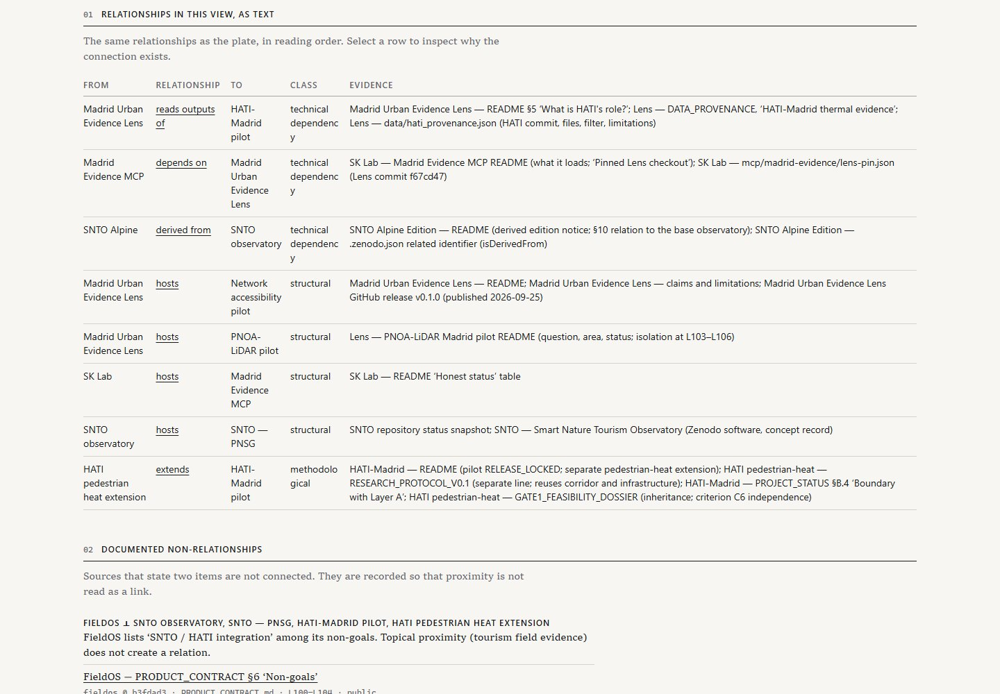 Text alternative of the current view | 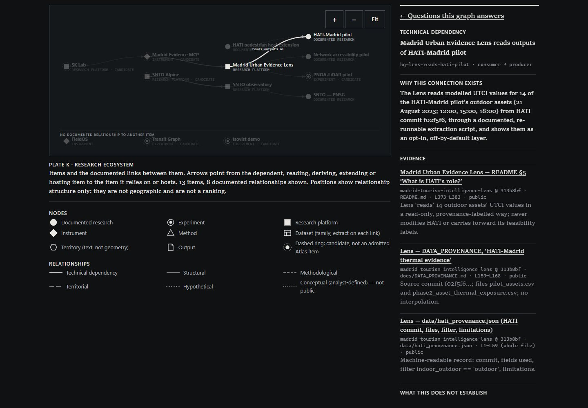 Dark theme |
| 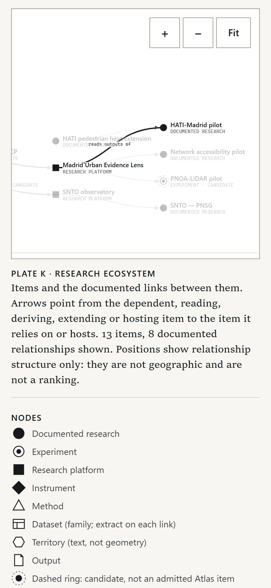 390 px, centred on the selection | 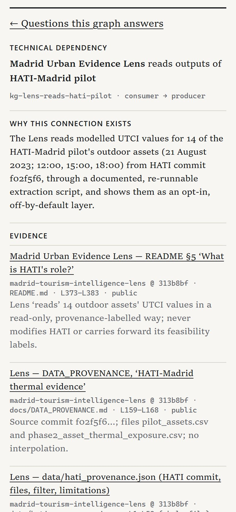 390 px, link detail |

Also: `13-neighbourhood-mobile-390.jpg`, `14-text-alternative-mobile-390.jpg`.

## 8. Scientific governance for v0.4

- **Inclusion:** a relationship is public only if all of these hold:
  - both ends are admitted Atlas items, or v0.4 dataset, method or territory
    nodes;
  - it uses an approved predicate whose domain and range fit;
  - it cites at least one public source pinned to a full commit SHA, DOI or
    tag, with a path and line locator;
  - for technical links, the source is in the dependent item's own
    repository.
- **Evidence and interpretation:** each record carries a plain explanation,
  the extract used (for datasets), and limits that are always displayed. The
  predicate's own limits and inference rules are shown with every link.
- **Verification:** two separate kinds, as in v0.3. The validator checks
  metadata only. A human reviewer confirms that each cited passage supports
  each link, recorded per link in the v0.4 freeze. Until then every link is
  shown as "AI-assisted source check; human verification pending".
- **Licences:** linking to and describing a public repository is not reuse of
  its content. No figure, geometry or text is copied from candidates in this
  proposal. Admission of an item without a licence is escalation E1.
- **Public vs private:** private repositories are excluded and never cited.
  Nothing in this proposal reads a private source.
- **Conceptual and hypothetical:** conceptual links are inventory only.
  Hypothetical links require a source that names the target and the
  condition, stay off by default and never count as use.
- **Versioning:** v0.4 adds `data/relationships.json` with its own schema
  (`0.4.0`) and leaves `data/atlas.json` schema `0.3.0` and its records
  unchanged. SPEC I7 is replaced, for v0.4 only, by the inclusion rules
  above. Tags `v0.1.0`–`v0.2.1` (and `v0.3.0` if created) stay immutable.
- **A2 stays open.** Nothing here implies that v0.3 passed A2. The graph shows
  "human verification pending" on every Atlas item.

## 9. Escalations (maintainer decisions)

| # | Question | Recommendation |
|---|---|---|
| E1 | Can a public repository **without a licence** (SK Lab, and so the MCP) be an Atlas node, if the Atlas only links to it and copies nothing? v0.3 deferred the MCP for "licence and pinned report". | Yes, as a node stating `license.code: none`, which the v0.3 schema already allows; or ask the owner to add a licence first. The decision is yours. |
| E2 | Which candidates enter v0.4? | MCP, PNOA-LiDAR pilot, Transit Graph, Isovist Demo. SNTO Alpine and SK Lab only if the derivative and hosting links are wanted. |
| E3 | The MCP depends on Lens `f67cd47`; the Lens dossier describes `3035323`. | Show both pins on the link (the prototype already does); do not re-pin either. |
| E4 | Should this PR's prototype directory be merged to `main`? Merging publishes it on GitHub Pages. | **Do not merge it as is.** Approve the proposal, then implement in governed gates. Keep the PR as a draft record, or merge only `docs/v0.4/` once approved. |
| E5 | The hypothetical VIS-001 → FieldOS link reads a caveat as a possible application. | Keep it as the single, off-by-default example, or drop it. Both are defensible. |

## 10. Acceptance criteria for v0.4

| # | Criterion |
|---|---|
| K1 | `data/atlas.json` v0.3 records unchanged; every v0.3 invariant still passes. |
| K2 | Every public relationship has a recorded **human** verification against its pinned lines. |
| K3 | The validator (I19–I27, from G0–G9) passes with zero errors in CI. |
| K4 | No public conceptual link; hypothetical links off by default; no public link to a deferred node. |
| K5 | Every link shows explanation, pinned source with locator, limits and verification state; every node links to its dossier. |
| K6 | Each item without a documented relationship is shown as such in each view. |
| K7 | Layout and order are deterministic; nothing ranks or scores items. |
| K8 | Every view state is deep-linkable and survives reload; a text alternative lists the same links. |
| K9 | axe-core 0 violations at 360–1440 px in light, dark and forced colours; full keyboard operation; 200 % zoom; no horizontal page scroll. |
| K10 | Zero third-party requests; static GitHub Pages deployment unchanged. |
| K11 | Each new item has its own content freeze (question, method, result, claim ceiling, pins) before any link to it is published. |
| K12 | A2 for v0.3 is reported as it stands; nothing implies that it passed. |

## 11. Minimal implementation plan

1. **Spec gate (governed):** `SPEC.md` v0.4 sections for relationships, the
   `#/relations` view and invariants I19–I27; `DESIGN_CONTRACT.md` line
   patterns and glyphs. Decide E1–E5.
2. **Content freeze:** freeze the admitted candidates (K11), then freeze
   `data/relationships.json` with human verification per link (K2).
3. **Implementation (governed):** `js/relations.js` from the prototype, the
   `#/relations` route, links from dossiers, validator rules in
   `tools/validate_atlas.py`, CI.
4. **Verification and release:** K1–K12, then a `v0.4.0` tag only with
   authorisation.

Estimated new runtime: one module (about 900 lines), one data file (about
40 KB) and about 150 lines of CSS. No dependency.
